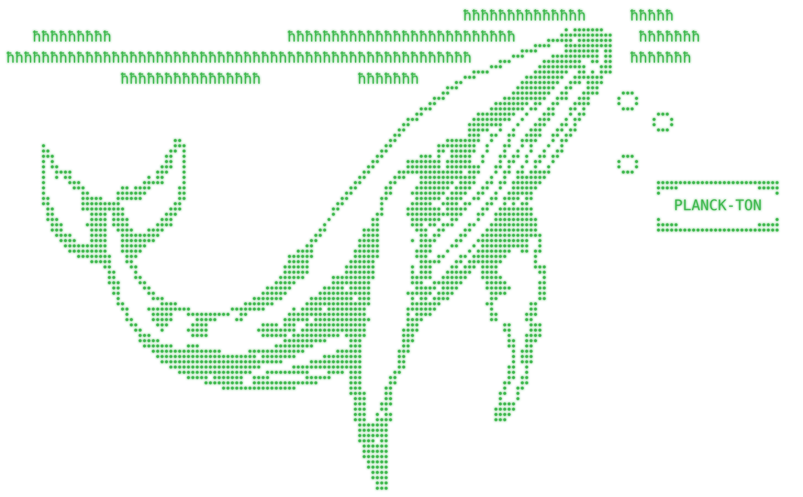

<p align="center"></p>

<!-- IN THE FOLLOWING, THE BRAILLE ART.
```
⠀⠀⠀⠀⠀⠀⠀⠀⠀⠀⠀⠀⠀⠀⠀⠀⠀⠀⠀⠀⠀⠀⠀⠀⠀⠀⠀⠀⠀⠀⠀⠀⠀⠀⠀⠀⠀⠀⠀⠀⠀⠀⠀⠀       ⠀ħħħħħħħħħħħħħħ⠀⠀  ⠀ħħħħħ⠀⠀⠀⠀⠀⠀⠀
⠀⠀ ħħħħħħħħħ⠀⠀⠀⠀⠀⠀        ⠀⠀⠀⠀⠀⠀ħħħħħħħħħħħħħħħħħħħħħħħħħħ⠀⠀⣀⣠⠤⢾⣞⣿⣿⣿⣶⠀  ħħħħħħħ⠀⠀⠀
ħħħħħħħħħħħħħħħħħħħħħħħħħħħħħħħħħħħħħħħħħħħħħħħħħħħħħ⠀⠀⣀⡤⠔⠚⠉⢁⣤⣶⣾⣿⣟⠻⢇⣿⠀ ħħħħħħħ
⠀⠀⠀⠀⠀⠀⠀⠀⠀⠀   ħħħħħħħħħħħħħħħħ  ⠀⠀⠀⠀⠀⠀⠀  ħħħħħħħ⠀⠀⠀⣀⡤⠒⠋⠉⠀⠀⠀⣠⣶⣿⣿⡿⢋⡴⠟⣾⡾⠉⠀⠀⠀
⠀⠀⠀⠀⠀⠀⠀⠀⠀⠀⠀⠀⠀⠀⠀⠀⠀⠀⠀⠀⠀⠀⠀⠀⠀⠀⠀⠀⠀⠀⠀⠀⠀⠀⠀⠀⠀⠀⠀⠀⠀⠀⠀⠀⠀⠀⠀⣀⡴⠚⠁⠀⠀⠀⠀⣠⣴⣾⣿⢟⡿⢋⡴⠛⣠⢾⠏⠁ ⠰⣉⡱⠀⠀⠀⠀⠀⠀⠀
⠀⠀⠀⠀⠀⠀⠀⠀⠀⠀⠀⠀⠀⠀⠀⠀⠀⠀⠀⠀⠀⠀⠀⠀⠀⠀⠀⠀⠀⠀⠀⠀⠀⠀⠀⠀⠀⠀⠀⠀⠀⠀⠀⠀⢀⡴⠚⠁⠀⠀⠀⠀⢠⣾⣿⠿⡟⢋⠔⢁⣴⠟⢁⡴⣱⠋⠀      ⠰⣉⡱⠀⠀⠀⠀
⠀⠀⠀⠀⣄⠀⠀⠀⠀⠀⠀⠀⠀⠀⠀⠀⠀⠀⢀⡶⡄⠀⠀⠀⠀⠀⠀⠀⠀⠀⠀⠀⠀⠀⠀⠀⠀⠀⠀⠀⠀⠀⢀⡴⠋⠀⠀⠀⠀⣤⢶⣶⣾⡟⢠⠋⢠⠏⡰⢻⠋⡠⢋⡞⠁     
⠀⠀⠀⠀⡏⢧⣀⡀⠀⠀⠀⠀⠀⠀⠀⠀⠀⣠⡿⠀⡇⠀⠀⠀⠀⠀⠀⠀⠀⠀⠀⠀⠀⠀⠀⠀⠀⠀⠀⠀⢀⡴⠋⠀⢀⣰⣶⣿⣷⣇⣾⣿⢿⣤⠃⢠⢏⡞⣡⢃⣞⣡⠋⠀⠀⠀⠀  ⠰⣉⡱ 
⠀⠀⠀⠀⡇⠈⠈⠳⢦⡀⠀⠀⢀⣤⣠⣴⠗⠛⠀⢠⡇⠀⠀⠀⠀⠀⠀⠀⠀⠀⠀⠀⠀⠀⠀⠀⠀⠀⢀⡴⠋⠀⠀⣴⠋⠁⣠⣿⣿⣿⢟⣽⡿⢃⡴⢃⠞⣰⣿⣿⠟⠁⠀⠀⠀⠀⠀⠀⠀⠀⠀  ⠀⡶⠶⠖⠒⠒⠒⠒⠒⠒⠒⠒⠲⠶⢶⠀⠀
⠀⠀⠀⠀⢻⡄⠀⠀⠸⢿⣿⡶⣾⡍⠉⠁⠀⠀⣠⡾⠁⠀⠀⠀⠀⠀⠀⠀⠀⠀⠀⠀⠀⠀⠀⠀⠀⡴⠋⠀⠀⠀⣸⠁⠀⢠⣾⣿⣯⣕⣿⣯⠖⢉⡴⢋⣼⣽⣵⣯⠀⠀⠀⠀⠀⠀⠀⠀⠀⠀   ⠀  PLANCK-TON 
⠀⠀⠀⠀⠈⢿⣆⡀⠀⢺⣿⡇⠻⣿⣄⣀⣤⡾⠛⠀⠀⠀⠀⠀⠀⠀⠀⠀⠀⠀⠀⠀⠀⠀⠀⣠⠎⠀⠀⠀⢠⣼⡇⠀⠀⠀⠻⣯⢛⡵⠚⢁⡴⠊⣠⣾⣿⣿⣿⣿⣇⠀⠀⠀⠀⠀⠀⠀⠀⠀    ⠷⠶⠦⠤⠤⠤⠤⠤⠤⠤⠤⠴⠶⠾
⠀⠀⠀⠀⠀⠀⠙⠿⣶⣾⣿⣇⠀⢿⣿⠟⠉⠀⠀⠀⠀⠀⠀⠀⠀⠀⠀⠀⠀⠀⠀⠀⣀⣤⣾⠁⠀⠀⠀⢠⣿⣿⡇⠀⠀⠀⢡⣿⠏⣀⠔⢋⡠⣪⣿⣿⣿⠟⠻⠇⡼⠀⠀⠀⠀⠀⠀⠀⠀⠀⠀⠀⠀⠀⠀
⠀⠀⠀⠀⠀⠀⠀⠀⠀⠈⠉⢻⡄⠈⢳⡀⠀⠀⠀⠀⠀⠀⠀⠀⠀⠀⠀⠀⠀⠀⠀⣰⣿⣿⠇⠀⠀⣀⣰⣿⣿⣿⠀⠀⠀⠀⣆⣿⡏⢁⣴⣯⡾⠋⣿⣿⡁⠀⠀⠀⠳⡆⠀⠀⠀⠀⠀⠀⠀⠀⠀⠀⠀⠀⠀
⠀⠀⠀⠀⠀⠀⠀⠀⠀⠀⠀⠈⢿⠀⠀⠙⢦⣀⠀⠀⠀⠀⠀⠀⠀⠀⠀⠀⣀⣴⣾⡿⠋⠀⢀⣠⣶⣿⣯⡿⣿⡇⠀⠀⠀⠠⡽⣷⢞⣽⡿⠋⠀⠀⠘⣿⠿⠂⠀⠀⢸⡇⠀⠀⠀⠀⠀⠀⠀⠀⠀⠀⠀⠀⠀
⠀⠀⠀⠀⠀⠀⠀⠀⠀⠀⠀⠀⠈⢳⡀⠀⢲⣾⣿⠓⠲⢤⣤⣤⠤⠔⣲⠟⠛⠋⠁⢀⣴⣴⡿⣿⣽⣿⣿⣿⣿⡁⠀⠀⠀⢰⣻⡿⠟⠁⠀⠀⠀ ⠀⠈⣧⠀⠀⠀⣼⠇⠀⠀⠀⠀⠀⠀⠀⠀⠀⠀⠀⠀⠀⠀
⠀⠀⠀⠀⠀⠀⠀⠀⠀⠀⠀⠀⠀⠀⠙⣦⣄⡙⠁⠀⠐⠿⠿⠀⠀⠀⠀⠀⠐⠿⠿⢾⣻⣴⣿⣿⡿⠿⠻⣿⡿⠀⠀⠀⠀⣾⡟⠀⠀⠀⠀⠀⠀⠀⠀⠀⠘⣇⠀⣼⡿⠀⠀⠀⠀⠀⠀⠀⠀⠀⠀⠀⠀⠀⠀
⠀⠀⠀⠀⠀⠀⠀⠀⠀⠀⠀⠀⠀⠀⠀⠈⠙⢿⣿⣶⣾⣿⣶⣶⣦⣤⣤⣴⣖⣶⣾⡿⠿⠛⢉⣀⣤⣴⣶⣿⡇⠀⠀⠀⢰⡟⠀⠀⠀⠀⠀⠀⠀⠀⠀⠀⠀⢹⢰⣿⠀⠀⠀⠀⠀⠀⠀⠀⠀⠀⠀⠀⠀⠀⠀
⠀⠀⠀⠀⠀⠀⠀⠀⠀⠀⠀⠀⠀⠀⠀⠀⠀⠀⠈⠙⠻⠿⢿⣻⣿⣿⣿⠛⣭⣴⣒⣒⣚⣛⣯⡭⠽⠛⠋⣿⡇⠀⠀⢠⡞⠁⠀⠀⠀⠀⠀⠀⠀⠀⠀⠀⢀⡿⢠⡇⠀⠀⠀⠀⠀⠀⠀⠀⠀⠀⠀⠀⠀⠀⠀
⠀⠀⠀⠀⠀⠀⠀⠀⠀⠀⠀⠀⠀⠀⠀⠀⠀⠀⠀⠀⠀⠀⠀⠀⠈⠉⠉⠉⠉⠉⠉⠉⠉⠀⠀⠀⠀⠀⠀⢻⣷⠀⢀⣿⠀⠀⠀⠀⠀⠀⠀⠀⠀⠀⠀⠀⣞⣀⠏⠀⠀⠀⠀⠀⠀⠀⠀⠀⠀⠀⠀⠀⠀⠀⠀
⠀⠀⠀⠀⠀⠀⠀⠀⠀⠀⠀⠀⠀⠀⠀⠀⠀⠀⠀⠀⠀⠀⠀⠀⠀⠀⠀⠀⠀⠀⠀⠀⠀⠀⠀⠀⠀⠀⠀⠸⣿⣀⣮⡷⠀⠀⠀⠀⠀⠀⠀⠀⠀⠀⠀⠸⠿⠋⠀⠀⠀⠀⠀⠀⠀⠀⠀⠀⠀⠀⠀⠀⠀⠀⠀
⠀⠀⠀⠀⠀⠀⠀⠀⠀⠀⠀⠀⠀⠀⠀⠀⠀⠀⠀⠀⠀⠀⠀⠀⠀⠀⠀⠀⠀⠀⠀⠀⠀⠀⠀⠀⠀⠀⠀⠀⢿⣿⣻⡇⠀⠀⠀⠀⠀⠀⠀⠀⠀⠀⠀⠀⠀⠀⠀⠀⠀⠀⠀⠀⠀⠀⠀⠀⠀⠀⠀⠀⠀⠀⠀
⠀⠀⠀⠀⠀⠀⠀⠀⠀⠀⠀⠀⠀⠀⠀⠀⠀⠀⠀⠀⠀⠀⠀⠀⠀⠀⠀⠀⠀⠀⠀⠀⠀⠀⠀⠀⠀⠀⠀⠀⠘⣿⣿⡇⠀⠀⠀⠀⠀⠀⠀⠀⠀⠀⠀⠀⠀⠀⠀⠀⠀⠀⠀⠀⠀⠀⠀⠀⠀⠀⠀⠀⠀⠀⠀
⠀⠀⠀⠀⠀⠀⠀⠀⠀⠀⠀⠀⠀⠀⠀⠀⠀⠀⠀⠀⠀⠀⠀⠀⠀⠀⠀⠀⠀⠀⠀⠀⠀⠀⠀⠀⠀⠀⠀⠀⠀⠘⣿⡇⠀⠀⠀⠀⠀⠀⠀⠀⠀⠀⠀⠀⠀⠀⠀⠀⠀⠀⠀⠀⠀⠀⠀⠀⠀⠀⠀⠀⠀⠀⠀
 
```
Note: letters and braille may have different spacing depending on the font.
-->
